# cat-blog v1.0 验收记录

> 日期：2026-11-25。按 [v1.0-implementation.md](v1.0-implementation.md) §5（D41）逐项检查。
> 环境：Amp orb（Linux x64），Rust 1.100，Docker 29.9.3 加 Compose v2.40.3，Caddy 2（`caddy:2` 镜像）。
> 被测版本：`origin/main` 的 `236fe66` 加上本次验收中的两处修复（见文末）。

结论：四项全部通过。验收中发现两个问题，都已修复并补了回归测试，修复后重新检查了受影响的项。

## 5.1 D20 功能逐项可用

在 §5.3 的 Docker 加 Caddy 部署上，用 `curl` 和浏览器检查。

| 项 | 结果 | 依据 |
|---|---|---|
| `/feed.xml`：RSS 2.0，最近 20 篇，全文，绝对地址，guid 稳定 | 通过 | `Content-Type: application/rss+xml`，XML 解析通过；不含草稿和页面；再发布 18 篇、可见文章共 21 篇时，RSS 正好 20 篇，只少了最早的一篇；`<description>` 是全文 HTML，脚注 `#fn-1` 等页内链接改成了文章的绝对地址；`<guid isPermaLink="false">urn:cat-blog:1:{id}</guid>` |
| `/sitemap.xml`、`/robots.txt` | 通过 | sitemap 含首页、`/blog/`、页面和所有可见文章，中文 slug 百分号编码；robots 为 `Disallow: /admin/` 并给出 sitemap 绝对地址 |
| 文章 `tags` 与 `/blog/?tag=x` 筛选 | 通过 | 文章页标题下显示 `#rust #示例`，链接到 `/blog/?tag=…`；`?tag=rust` 与 `?tag=RUST` 结果相同，`?tag=nope` 返回空列表（200） |
| 编辑器预览，在新标签页打开，不写库 | 通过 | 预览按钮带 `formaction="/admin/preview" formtarget="_blank"`；预览响应 200、带 `noindex` 和 `Cache-Control: no-store`；预览前后文章数都是 5，预览内容的地址返回 404 |
| 删除前确认，确认后从数据库删除 | 通过 | `GET /admin/delete/5` 显示确认页，此时文章仍可公开访问；确认后 303 回列表，公开地址和编辑页都返回 404，备份出的数据库里 `posts` 已没有这一行 |
| 内置 CSS，暗色模式，手动切换按钮，禁用 JS 时跟随系统 | 通过 | 系统亮色、未选择时背景 `rgb(253,253,252)`；点切换按钮后变为 `rgb(22,24,29)`，并在下一页保持；再点回到亮色。禁用 JS（`--blink-settings=scriptEnabled=false`）时：系统暗色下背景 `rgb(22,24,29)`，系统亮色下 `rgb(253,253,252)`，切换按钮 `display: none` |
| 服务端代码高亮（CSS class），亮暗两套 | 通过（修复后） | 输出 `hl-` 前缀的 class，无内联样式；亮色 `.hl-storage` 为 `rgb(167,29,93)`，暗色为 `rgb(180,142,173)`，禁用 JS 时也随系统切换。验收中发现并修复了问题 1 |
| `{{ posts }}`，`limit`、`tag` 两个参数 | 通过 | 首页写 `{{ posts limit:2 }}` 只列出最近两篇；`{{ posts tag:Rust }}` 规范化后只列出两篇带 `rust` 标签的文章 |

## 5.2 D23 测试全绿

| 项 | 结果 | 依据 |
|---|---|---|
| `cargo fmt --check`、`cargo clippy -- -D warnings`、`cargo test` 在 CI 上通过 | 通过 | 本地 `scripts/check.sh`（fmt、clippy、test、`sqlx prepare --check`、`cargo deny`、架构检查）全部通过，共 139 个测试；CI 在 push 时跑同一个脚本 |
| 阶段 1 的单元测试表全部覆盖 | 通过 | 表中每个用例都对应到具体测试并检查了断言内容，例如 slug 截断（`slug.rs` `long_title_is_truncated_without_trailing_dash`）、写回幂等（`frontmatter/tests.rs` `write_back_is_idempotent`）、纽约夏令时边界（`date.rs` `daylight_saving_boundaries_in_new_york`） |
| 阶段 3、4、5 列出的集成测试全部存在并通过 | 通过 | 阶段 3 的 7 项在 `tests/http/public.rs`；阶段 4 的 6 项在 `tests/http/admin.rs`、`tests/http/login.rs`；阶段 5 的备份测试在 `tests/process/backup.rs`（并发写入、`integrity_check`、新进程打开副本、目标已存在报错、权限 600，现在也检查新建目录的权限 700） |

用例和测试的对应关系（逐个读过断言，确认检查的是用例要求的行为）：

| 用例 | 测试（文件：函数） |
|---|---|
| slug：示例标题、全角标点、NFD、连续标点合并、全是标点 | `core/src/slug.rs`：`title_example_from_spec`、`full_width_punctuation_becomes_separator`、`nfd_input_is_composed`、`runs_of_punctuation_merge_into_one_dash`、`only_punctuation_is_empty` |
| slug：80 字符截断不以 `-` 结尾、保留路径含大小写变体 | `slug.rs`：`long_title_is_truncated_without_trailing_dash`、`reserved_paths_are_rejected_in_any_case` |
| frontmatter：未知字段行号、类型错误、缺结束 `---`、CRLF、页面写 `tags`、`tags: rust` | `core/src/frontmatter/tests.rs`：`unknown_field_reports_its_line`、`wrong_types_report_field_and_line`、`missing_front_matter_or_closing_fence`、`crlf_input_parses_with_same_lines`、`page_with_tags_is_rejected`、`tags_as_single_string_is_rejected` |
| slug 写回：插在 `title:` 后、只替换值、注释不动、`2024` 加引号、多行报错、幂等 | `frontmatter/tests.rs`：`write_back_inserts_after_title`、`write_back_replaces_only_the_slug_value`、`write_back_keeps_comment_on_slug_line`、`numeric_slug_is_quoted`、`multiline_slug_is_rejected`、`write_back_is_idempotent` |
| date：三种写法、只写日期取站点时区零点、纽约夏令时边界、非法时区 | `core/src/date.rs`：`three_accepted_forms`、`date_only_is_local_midnight_in_site_timezone`、`daylight_saving_boundaries_in_new_york`、`unknown_timezone_is_rejected` |
| published_at：首次发布取 now、撤回再发布保留、`date` 优先 | `date.rs`：`first_publish_takes_now`、`republishing_after_unpublish_keeps_first_time`、`explicit_date_wins` |
| visibility：草稿、未来时间、为空、恰好等于 now | `core/src/visibility.rs`：`draft_is_hidden_even_when_published_before`、`future_publish_time_is_hidden`、`missing_publish_time_is_hidden`、`publish_time_equal_to_now_is_visible` |
| directive：参数顺序、未知参数、行内和代码块不展开 | `core/src/directive.rs`：`params_in_any_order`、`bad_params_are_errors`；`core/src/markdown.rs`：`directive_inline_or_in_code_is_left_as_text` |
| sanitize：script 和事件属性、`javascript:`/`data:`、iframe 黑白名单、checkbox `disabled`、伪造占位注释 | `core/src/sanitize.rs`：`scripts_and_event_handlers_are_removed`、`javascript_and_data_links_are_removed`、`other_iframes_are_removed_entirely`、`whitelisted_iframes_are_kept`、`checkboxes_are_forced_disabled`、`author_comments_cannot_forge_posts_placeholder` |
| markdown：表格、脚注、任务列表、标题锚点、高亮 class、`
` | `markdown.rs`：`table_survives_sanitizing`、`footnotes_survive_sanitizing`、`task_list_checkboxes_survive_disabled`、`heading_anchors_survive`、`highlight_classes_survive`、`details_survive` |
| 阶段 3：可见 200、草稿 404、未来 404、`/Foo` 301、中文 slug、RSS、`?tag=` | `server/tests/http/public.rs`：`visible_post_is_served`、`draft_returns_404`、`future_post_returns_404_until_its_time`、`non_canonical_paths_redirect_permanently`、`percent_encoded_chinese_slug_is_served`、`feed_lists_only_visible_posts_with_absolute_urls`、`tag_filter_is_case_insensitive` |
| 阶段 4：完整流程、缺 `_csrf`、`Origin` 不符、第 6 次 429、改标题 URL 不变、冲突 slug 422 | `tests/http/admin.rs`：`full_flow_login_publish_draft_logout`、`renaming_title_keeps_the_url`、`conflicting_slug_returns_422_and_keeps_the_source`；`tests/http/login.rs`：`post_without_valid_csrf_returns_403`、`login_from_another_origin_returns_403`、`sixth_login_from_one_ip_within_15_minutes_returns_429` |
| 阶段 5：备份并发写入、完整性、新进程打开、已存在报错、权限 | `tests/process/backup.rs`：`backup_while_writing_is_consistent_private_and_never_overwrites` |

## 5.3 Docker + Caddy 冒烟部署

在新建的 orb 里从零安装 Docker 和 Compose，`deploy/.env` 写入 `BASE_URL=https://localhost`（Caddy 用内部 CA 签发证书，`curl -k`）。

| 项 | 结果 | 依据 |
|---|---|---|
| `docker compose up -d --build` 成功，`/healthz` 返回 `ok` | 通过 | 两个容器都在运行，cat-blog 不对宿主机暴露端口；经 Caddy 访问 `https://localhost/healthz` 返回 `ok`；`http://` 被 308 跳到 `https://` |
| 通过 Caddy 的 HTTPS 地址访问首页，看到默认欢迎文字 | 通过 | HTTP/2 200，正文为“欢迎来到 cat-blog！” |
| 登录后台，cookie 带 `Secure`、`HttpOnly`、`SameSite=Lax` | 通过 | `set-cookie: cat_blog_session=…; Path=/; Max-Age=2592000; HttpOnly; SameSite=Lax; Secure` |
| 新建并发布一篇带中文 slug 的文章，公开访问正常，出现在 RSS 中 | 通过 | 《你好，世界》得到 slug `你好-世界`；`/%E4%BD%A0%E5%A5%BD-%E4%B8%96%E7%95%8C/` 返回 200；RSS 中有该文章的绝对地址 |
| 同一客户端输错 5 次后 429，另一个客户端 IP 仍能登录（D38） | 通过 | 宿主机客户端：第 1–5 次 422，第 6 次 429，之后正确密码也是 429，伪造 `X-Forwarded-For: 9.9.9.9` 仍是 429（Caddy 不信任客户端传来的这个头）；同一 compose 网络里另起一个容器（另一个源 IP）用正确密码登录，303 并拿到会话 |
| `docker compose exec cat-blog cat-blog backup /data/backups/x.db` 成功；用副本按恢复步骤恢复后数据完整 | 通过 | 备份成功，副本权限 `-rw-------`；备份后又发布一篇文章，再按 README 的 Docker 恢复步骤恢复：多出的那篇消失，备份前的文章、RSS 和备份前的登录会话都还在。验收中发现并修复了问题 2 |
| `docker compose restart` 后会话仍然有效，数据仍在 | 通过 | 重启后 `/healthz` 为 `ok`，原 cookie 访问 `/admin/posts/` 为 200，未登录仍 303 到登录页，文章仍为 200 |

修复后重新构建镜像，执行 `docker compose exec cat-blog cat-blog rerender`：6 篇重新渲染，0 篇失败，代码块改用新的 class。

## 5.4 截图检查

全部截图来自上面的 Docker 部署（Chromium，2 倍像素），每张左边亮色、右边暗色（按系统配色）。人工检查过排版、对比度、亮暗两套高亮和错误提示。下面是修复问题 1 之后的截图。

| 页面 | 结果 |
|---|---|
| 首页（含 `{{ posts }}` 列表） | 通过 |
| 文章页（代码块、表格、脚注、任务列表、`
`、中文长段落） | 通过（修复后） |
| `/blog/` 和 `?tag=` 结果 | 通过 |
| 404 页 | 通过 |
| 后台登录、列表、编辑页（含错误提示状态）、删除确认页 | 通过 |
| 窄屏（375px 宽）下的首页和文章页 | 通过：过长的代码行在代码块内横向滚动，页面本身不横向溢出（`scrollWidth` 375） |

### 首页

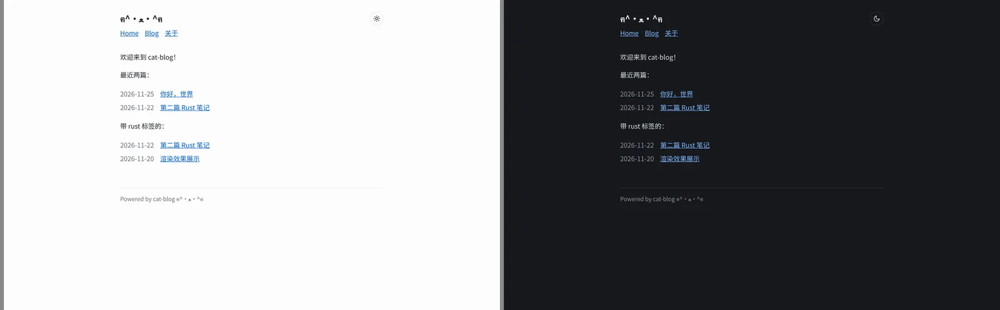

### 文章页

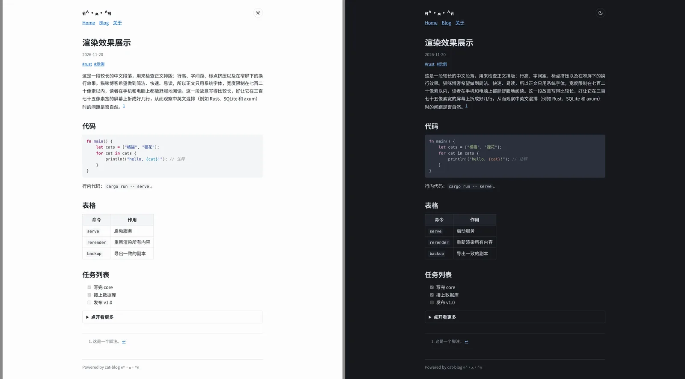

### `/blog/` 和 `?tag=rust`

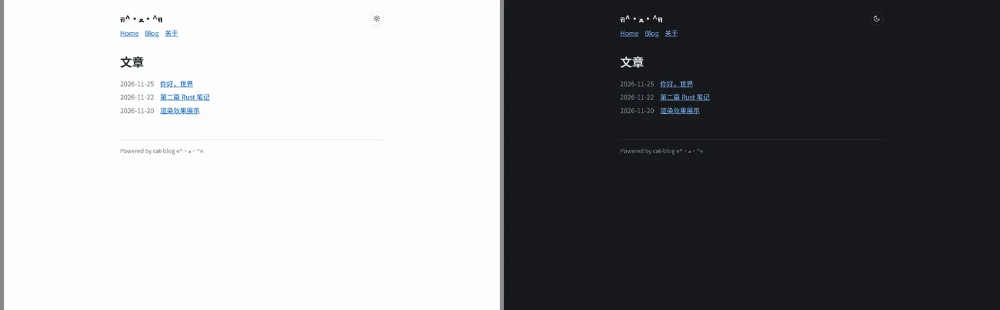

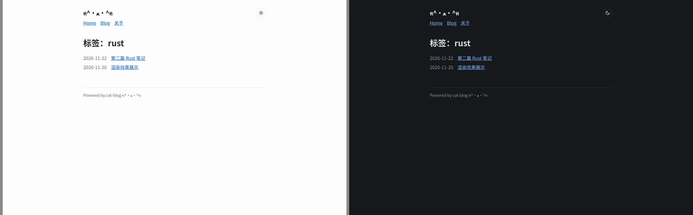

### 404 页

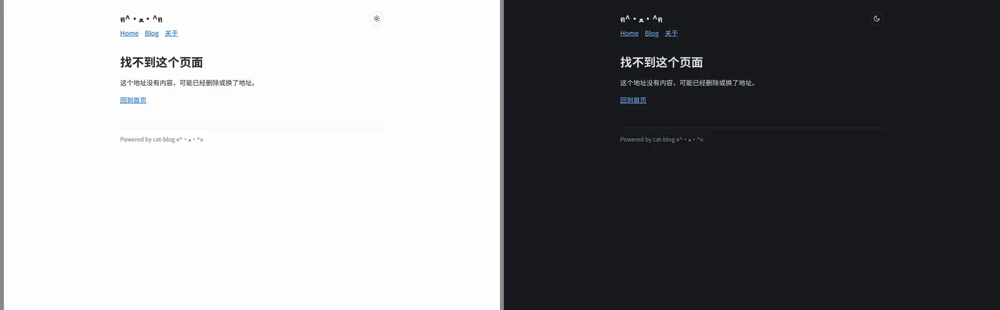

### 后台

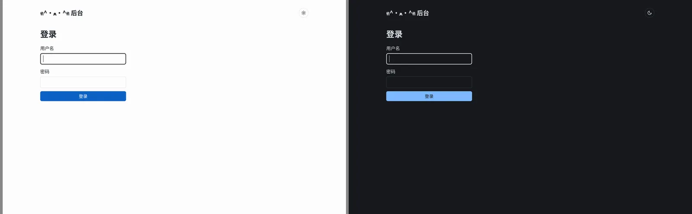

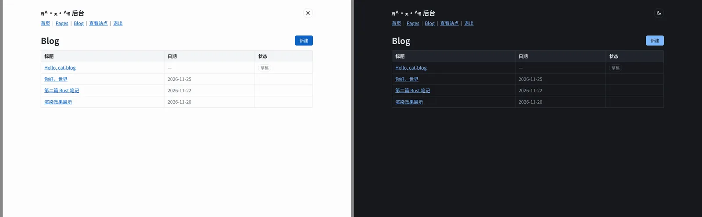

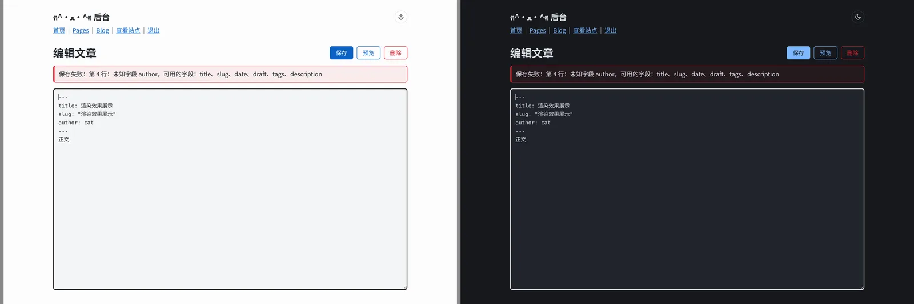

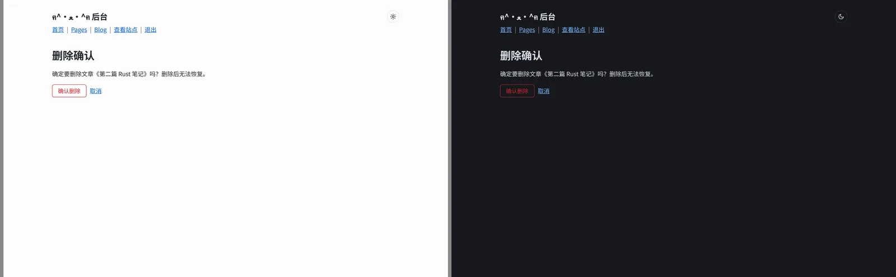

### 窄屏（375px）

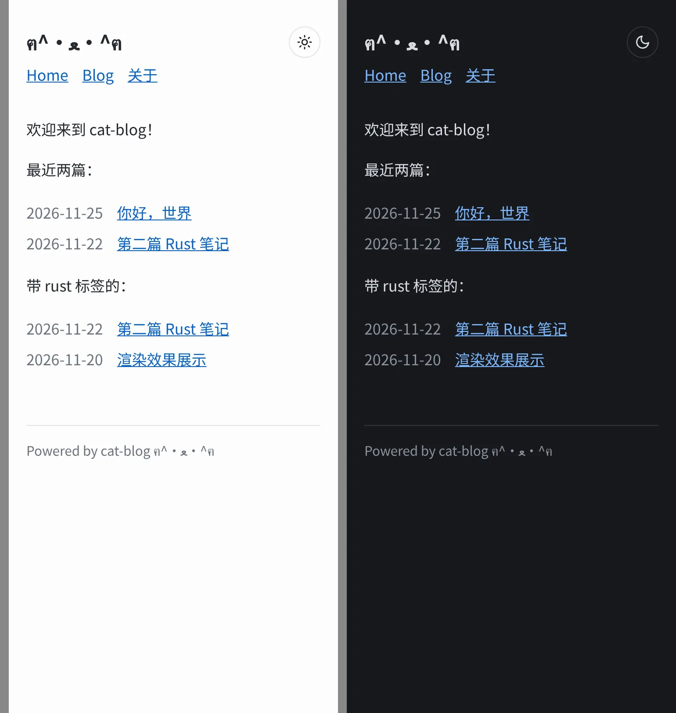

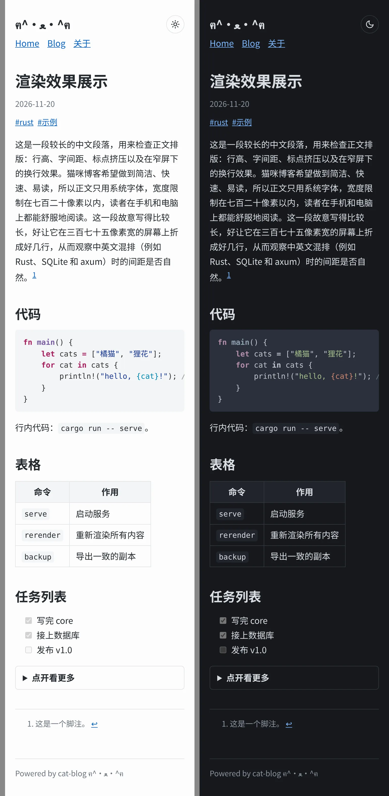

## 验收中发现并修复的问题

1. **代码块里的文字逐层变小**。syntect 输出的 class 没有前缀（`meta`、`string`、`comment` 等），和站点样式里文章日期行的 `.meta { font-size: 0.9em }` 撞名，代码块里每套一层 `span.meta` 就缩小一成，嵌套三四层后明显变小。修复：高亮 class 统一加 `hl-` 前缀（设计文档 D51 已补充），从根上避免两边的 class 互相影响。回归测试 `assets.rs` `highlighted_code_uses_no_class_that_the_site_stylesheet_styles`：渲染一段代码，检查输出的每个 class 都不被 `style.css` 使用；修复前失败（`style.css styles ["meta", …]`）。已有内容需执行一次 `cat-blog rerender`。
2. **`backup` 新建的目录权限跟随 umask**。容器里 umask 为 `0000` 时 `/data/backups` 被建成 `drwxrwxrwx`。副本文件本身一直是 600，读不到，但其他用户可以删除或替换目录里的备份。修复：目标目录不存在时以权限 700 创建（设计文档 §10.3 已补充）。回归断言加在 `tests/process/backup.rs`；修复前在 umask 022 下得到 755，测试失败。修复后在 umask 为 0 的容器里新建的目录是 `drwx------`。

## 未覆盖和遗留

- 本次只在一个干净的 orb 里做了冒烟部署，没有在公网域名上申请真实的 Let's Encrypt 证书。
- 阶段 5 记录的遗留项不变：备份完整性检查失败的分支没有测试；备份测试里的 `after > before` 依赖时序；`/data` 用宿主机目录挂载（bind mount）时属主需要手动设置。
- 没有测试只写日期且当地零点不存在的时区（如 `America/Santiago`），代码按"顺延到之后的第一个有效时间"处理。
